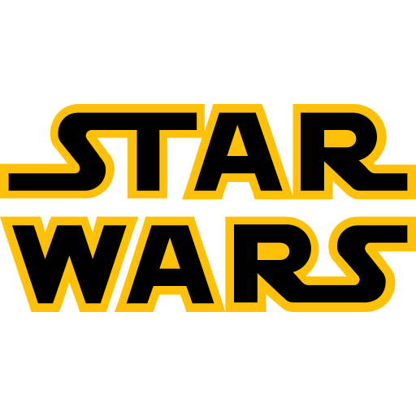
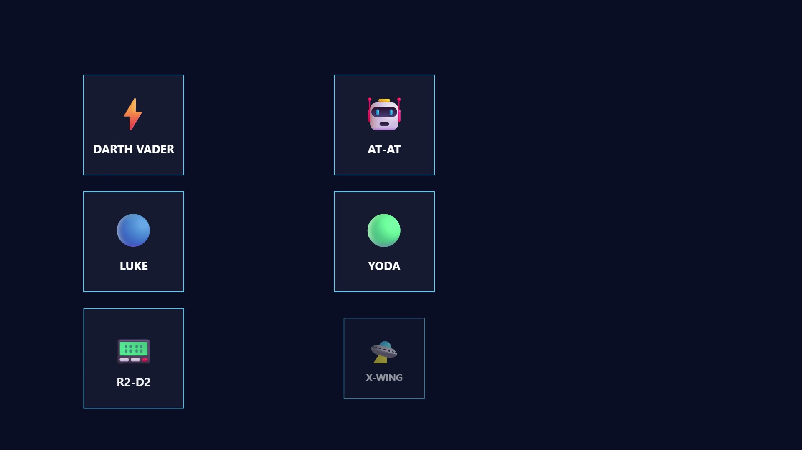
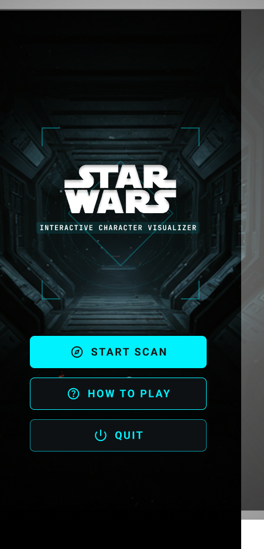
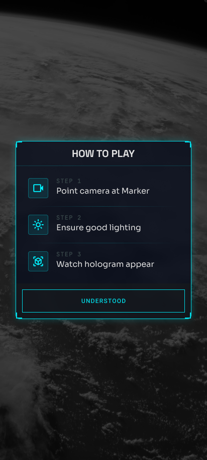
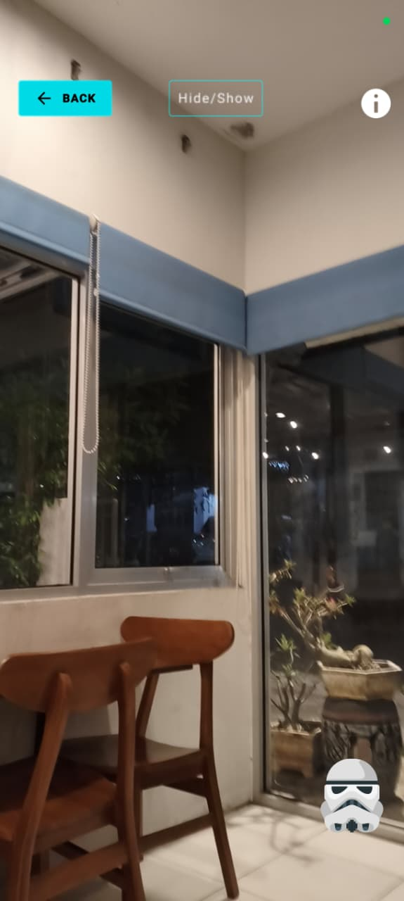
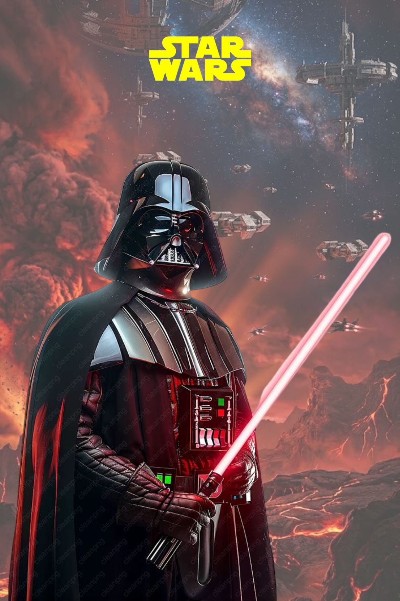
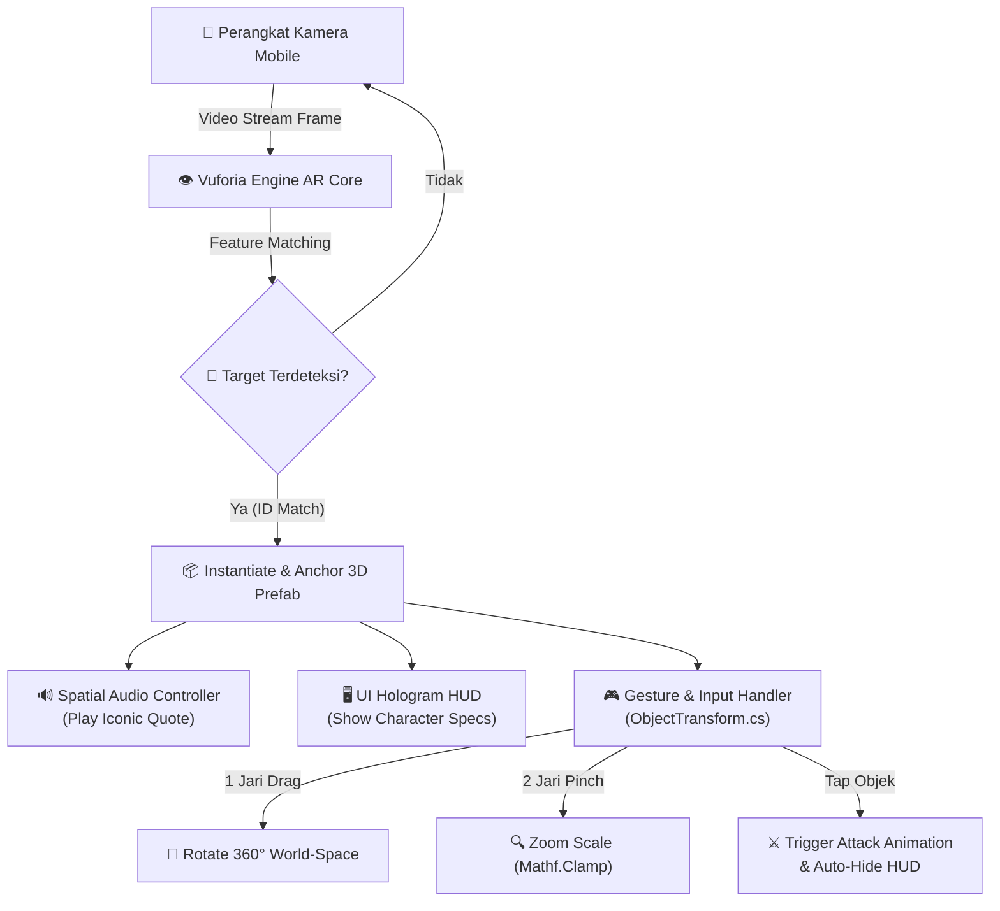

<div align="center">
  
  <h1>⚡ Star Wars AR — Interactive Character Visualizer</h1>
  <p><strong>An Immersive Augmented Reality Experience Bringing Iconic Star Wars Legends and Starfighters into the Physical World</strong></p>

  <p>
    <a href="https://github.com/UnnamedPeople-Chin/Star-Wars-AR-Interactive-Character-Visualizer"></a>
    <a href="https://github.com/UnnamedPeople-Chin/Star-Wars-AR-Interactive-Character-Visualizer/releases"></a>
    <a href="STAR_WARS_AR_DEMO.mp4"></a>
    
    
    
    <a href="https://www.figma.com/design/7rhe1Y7xD21xiXXjXMX1ep/AR-PROJECT"></a>
    
  </p>

  <p>
    <a href="#-about-the-project">About The Project</a> •
    <a href="#-demo-video-teaser">Demo Video</a> •
    <a href="#-visual-previews">Visual Previews</a> •
    <a href="#-key-features">Key Features</a> •
    <a href="#-system-architecture--tech-stack">Architecture & Tech Stack</a> •
    <a href="#-character--vehicle-roster">Roster & Mechanics</a> •
    <a href="#-project-directory-structure">Directory Structure</a> •
    <a href="#-getting-started--setup-guide">Getting Started</a> •
    <a href="#-team--credits">Team & Credits</a>
  </p>
</div>

---

## 📌 About The Project

**Star Wars AR — Interactive Character Visualizer** is a production-grade mobile Augmented Reality application that transforms static collectible posters into interactive 3D holographic experiences. Powered by **Unity 6** and **Vuforia Engine**, the app delivers sub-2-second target recognition to project high-fidelity characters and starfighters seamlessly into physical environments.

Users can explore iconic Star Wars legends—including **Darth Vader, Luke Skywalker, Master Yoda, R2-D2, AT-AT Walker, and X-Wing Starfighter**—complete with 360° orbital rotation, pinch-to-zoom scaling, dynamic attack animation triggers, authentic character voiceovers, and a Figma-designed sci-fi HUD.

---

## 🎬 Demo Video Teaser

<div align="center">
  <a href="https://media.githubusercontent.com/media/UnnamedPeople-Chin/Star-Wars-AR-Interactive-Character-Visualizer/main/STAR_WARS_AR_DEMO.mp4">
    
  </a>
  <p>
    <em>🎥 Tonton cuplikan demo 45 detik: Title intro &rarr; Pengenalan karakter &rarr; Interaksi sentuh &rarr; AR live montage. <a href="https://media.githubusercontent.com/media/UnnamedPeople-Chin/Star-Wars-AR-Interactive-Character-Visualizer/main/STAR_WARS_AR_DEMO.mp4"><strong>[Klik Di Sini Untuk Memutar Video MP4]</strong></a></em>
  </p>
</div>

---

## 📸 Visual Previews

<div align="center">
  <table width="100%" style="border-collapse: collapse; border: none; text-align: center;">
    <tr>
      <td width="50%" style="padding: 12px; border: none;">
        
        <br />
        <p><em><strong>Holographic Main Menu:</strong> Antarmuka bertema sci-fi dengan navigasi How-to-Play, Scan Camera, dan integrasi audio latar Star Wars Theme.</em></p>
      </td>
      <td width="50%" style="padding: 12px; border: none;">
        
        <br />
        <p><em><strong>Interactive HUD Guide:</strong> Panduan interaktif tata cara scan target, gestur sentuh, dan pemicu animasi karakter.</em></p>
      </td>
    </tr>
    <tr>
      <td width="50%" style="padding: 12px; border: none;">
        
        <br />
        <p><em><strong>Real-Time 3D Holographic Rendering:</strong> Visualisasi model 3D di atas permukaan nyata dengan pencahayaan dinamis dan panel data.</em></p>
      </td>
      <td width="50%" style="padding: 12px; border: none;">
        
        <br />
        <p><em><strong>High-Contrast Image Target:</strong> Kartu target teroptimasi dengan rasio fitur pelacakan tinggi untuk stabilitas tracking Vuforia.</em></p>
      </td>
    </tr>
  </table>
</div>

---

## 🚀 Key Features

### 1. 🎯 Computer Vision & Ultra-Fast Image Target Recognition
* **Sub-2-Second Detection**: Pelacakan marker instan berbasis *feature point extraction* Vuforia Engine dengan latensi minimal.
* **Rock-Solid 6-DoF Spatial Anchoring**: Objek 3D terkunci secara akurat pada bidang target poster meski kamera bergerak atau sudut pandang berubah miring.
* **Seamless Multi-Target Tracking**: Perpindahan otomatis antar poster karakter dan wahana tempur tanpa perlu mereset sesi aplikasi.

### 2. ⚔️ Dynamic 3D Animations & Attack State Machine
* **Dual-State Animator FSM**: Transisi halus antara status *Idle Animation* loop dan *Action/Attack Animation* berbasis trigger sekali sentuh (`SetTrigger`).
* **Tactile Tap-to-Interact**: Pengguna dapat menyentuh karakter untuk memicu sabetan *lightsaber*, manuver terbang X-Wing, atau simulasi jatuh AT-AT.
* **Vector Lerping Return Mechanic**: Script khusus (`Lerp`) mengembalikan posisi dan rotasi awal model kendaraan tempur secara mulus pasca animasi selesai.

### 3. 👆 Intuitive Multi-Touch Mobile Gestures
* **One-Finger 360° Orbital Rotate**: Sentuhan 1 jari (`TouchPhase.Moved`) memutar karakter secara horizontal pada sumbu dunia untuk inspeksi detail 3D 360 derajat.
* **Pinch-to-Zoom Scaling**: Gestur dua jari (`Pinch`) dengan perhitungan delta magnitude dan pembatasan skala aman (`Mathf.Clamp`) agar ukuran model tetap proporsional.
* **Desktop Fallback Simulation**: Dukungan penuh pengujian di Unity Editor menggunakan mouse *click-and-drag* tanpa perlu selalu me-rebuild ke perangkat HP.

### 4. 🌌 Sci-Fi HUD Interface & Spatial Audio Atmosphere
* **Figma-Engineered Holographic UI**: Desain komponen HUD futuristik (sudut braket, panel bio karakter, tombol neon) yang diimpor melalui *Figma Converter for Unity*.
* **Smart UI Auto-Dismiss**: Panel informasi samping otomatis menghilang saat animasi serangan dipicu untuk memberikan bidang pandang kamera yang lapang.
* **Iconic Character Voiceovers**: Pemutaran otomatis kutipan suara legendaris (seperti *"The Power of The Darkside"* & *"I am Luke Skywalker"*) saat model muncul dan disentuh.

---

## 🏛️ System Architecture & Tech Stack

### High-Level Data Flow



### Technology Matrix

| Kategori | Teknologi / Asset | Versi / Rincian | Fungsi Utama |
| :--- | :--- | :--- | :--- |
| **Engine** | **Unity Engine** | `6.4 (6000.4.3f1)` URP | Core engine render 3D, scene management, dan pipeline grafis mobile |
| **AR SDK** | **Vuforia Engine** | `10.x+` (Image Target DB) | Computer vision, feature point tracking, dan 6-DoF spatial anchoring |
| **Bahasa** | **C# (.NET)** | Modern C# Scripting | Logika interaksi, gesture calculation, UI event handling, dan state machine |
| **Gesture Input**| **Lean Touch & Native Touch** | `TouchPhase & InputSystem` | Manipulasi sentuh (rotasi orbital, pinch zoom, pointer raycast) |
| **UI/UX Design** | **Figma & FCU** | `Figma Converter for Unity` | Desain layout antarmuka sci-fi HUD, vektor komponen, dan typography |
| **3D Pipeline**  | **Blender & Mixamo** | `ActorCore / AccuRIG` | Optimasi mesh, auto-rigging tulang, dan baking animasi karakter |
| **Sound System** | **Unity AudioSource** | Spatial Sound 44.1kHz | Voiceover karakter orisinil, sfx tembakan/mesin, dan Star Wars Main Theme |
| **Platform Target**| **Android OS** | API Level 29+ (ARM64) | Target rilis format `.apk` untuk instalasi pada smartphone Android |

---

## 🎭 Character & Vehicle Roster

| Target Marker | Entitas | Sisi / Afiliasi | Aksi Interaktif | Suara / Dialog Ikonik |
| :---: | :--- | :---: | :--- | :--- |
|  | **Darth Vader** | Dark Side (Sith Lord) | Sabetan *Red Lightsaber Attack* & panel bio tertutup otomatis | *"The Power Of The Darkside"* |
|  | **Luke Skywalker** | Light Side (Jedi Knight) | Kuda-kuda serang *Green Lightsaber Combat* | *"I am Luke Skywalker"* |
|  | **Master Yoda** | Light Side (Grand Master) | Manuver lompatan akrobatik *Force Strike* | *"Fear leads to anger, anger leads to hate"* |
|  | **R2-D2** | Light Side (Astromech) | Rotasi kepala kubah & manuver maju interaktif | Suara siulan biner ikonik R2-D2 |
|  | **AT-AT Walker** | Galactic Empire | Efek runtuh tumbang dan reposisi dinamis | Suara dentuman meriam blaster & derap kaki baja |
|  | **X-Wing Starfighter** | Rebel Alliance | Manuver lepas landas (*Take-off flight path*) | Deru akselerasi mesin hyperdrive T-65B |

---

## 📂 Project Directory Structure

```text
Star-Wars-AR-Interactive-Character-Visualizer/
├── Assets/
│   ├── AT-AT/                   # Asset 3D, Material & TriggerJatuhATAT.cs
│   ├── Audio/                   # Koleksi file suara dialog karakter & tema utama
│   ├── D.A. Assets/             # Plugin Figma Converter for Unity (FCU)
│   ├── Darth Vader/             # Model 3D rig, material PBR, dan animasi Vader
│   ├── Figma/                   # Screen renders & vector asset hasil sinkronisasi Figma
│   ├── Icon/                    # Ikon aplikasi Star Wars & indikator trigger
│   ├── Image Target/            # Poster target (.jpg) & dokumen cetak target (.pdf)
│   ├── Luke Skywalker/          # Model 3D rig & animasi tempur Luke Skywalker
│   ├── Plugins/                 # Library pihak ketiga (Lean Touch, CW Common)
│   ├── Prefabs/                 # Prefab siap pakai (Canvas UI, Karakter, Partikel)
│   ├── R2-D2/                   # Model 3D & R2D2Controller.cs
│   ├── Scenes/
│   │   └── AR StarWars.unity    # Scene utama yang memuat AR Camera & Image Targets
│   ├── Sprites/                 # Background luar angkasa, HUD border, corner brackets
│   ├── TextMesh Pro/            # Custom font sci-fi & resource typography
│   ├── X-Wing/                  # Model 3D wahana tempur & TriggerTakeOffXWing.cs
│   ├── Yoda/                    # Model 3D & CharacterTapTrigger.cs
│   │
│   ├── CharacterInteraction.cs  # Event click pointer untuk memicu animasi & sembunyikan HUD
│   ├── ObjectTransform.cs       # Algoritma rotasi 1-jari dan pinch-to-zoom 2-jari
│   ├── QuitAplikasi.cs          # Pengendali keluar aplikasi secara aman
│   ├── TapCharacter.cs          # Pemicu pemutaran audio saat model disentuh
│   └── UIManager.cs             # Manajemen navigasi Canvas (Menu, Panduan, Mode Scan)
│
├── screenshots/                 # Preview visual beresolusi tinggi untuk dokumentasi
├── ProjectSettings/             # Konfigurasi Unity, Player Settings, dan Target Build
├── Packages/                    # Manifest paket Unity (URP, TextMeshPro, Vuforia)
└── README.md                    # Dokumentasi standar industri repositori ini
```

---

## 🛠️ Getting Started & Setup Guide

### Prasyarat Sistem
* **Unity Hub** versi terbaru.
* **Unity 6 (6000.4.3f1)** atau Unity LTS (2022.3.x+) dengan modul:
  * `Android Build Support`
  * `Android SDK & NDK Tools`
  * `OpenJDK`
* **Vuforia Engine AR** package (terinstal via Unity Package Manager atau tarball).
* Akun gratis di [Vuforia Developer Portal](https://developer.vuforia.com/) untuk lisensi pengembangan.

### Langkah Instalasi & Menjalankan Proyek

1. **Clone Repositori GitHub**
   ```bash
   git clone https://github.com/UnnamedPeople-Chin/Star-Wars-AR-Interactive-Character-Visualizer.git
   cd Star-Wars-AR-Interactive-Character-Visualizer
   ```

2. **Buka Proyek Melalui Unity Hub**
   * Buka **Unity Hub** -> Klik tombol **Add** -> Pilih folder hasil clone di atas.
   * Pastikan menggunakan versi Unity **6000.4.3f1** (atau versi Unity 6/2022 LTS yang sesuai).
   * Buka project dan tunggu hingga proses import asset selesai.

3. **Konfigurasi Lisensi Vuforia**
   * Di dalam Unity Editor, pilih menu **Window** > **Vuforia Configuration**.
   * Masukkan **App License Key** Anda yang didapatkan dari Vuforia Developer Portal.

4. **Buka Scene Utama**
   * Navigasikan ke panel Project: `Assets/AR StarWars.unity` (atau di folder `Assets/Scenes/`).
   * Dobel-klik scene untuk membuka hierarki AR Camera dan Image Target.

5. **Pengujian di Komputer (Unity Editor)**
   * Hubungkan webcam ke PC/Laptop Anda.
   * Klik tombol **Play (▶️)** di bagian atas Unity.
   * Arahkan webcam ke poster target (bisa dibuka di layar HP lain dari file `Assets/Image Target/Image Target.pdf`).
   * Tahan klik kiri mouse untuk memutar karakter atau klik pada karakter untuk memicu animasi serangan.

6. **Membangun APK untuk Android (Build)**
   * Buka **File** > **Build Settings...**
   * Pilih platform **Android** dan klik **Switch Platform**.
   * Pastikan scene `AR StarWars` berada dalam daftar *Scenes in Build*.
   * Hubungkan HP Android Anda via kabel USB (aktifkan *USB Debugging*), lalu klik **Build and Run** (atau pilih **Build** untuk menghasilkan file `.apk`).

---

## 👥 Team & Credits

Proyek ini dikembangkan oleh **Team 5** sebagai bagian dari pemenuhan proyek mata kuliah **Augmented Reality & Virtual Reality**:

| Nama Pengembang | Peran & Tanggung Jawab | Profil GitHub / Kontak |
| :--- | :--- | :--- |
| **Kafka Nafisa** | **Project Manager (PM)**<br/>*Requirement analysis, timeline coordination, PRD authoring* | [@kafkanafisa](https://github.com/) |
| **Anisa Aulia** | **UI/UX Designer**<br/>*Sci-Fi Holographic HUD styling, typography, Figma wireframes* | [@anisaaulia](https://github.com/) |
| **Jizdan Yuflikh R** | **3D Artist, Animator & Lead Developer**<br/>*3D character modeling, rigging, gesture controls & repo maintainer* | [@EVRT10](https://github.com/EVRT10) / [@UnnamedPeople-Chin](https://github.com/UnnamedPeople-Chin) |
| **Nazriel Farras Khairiya P. S.** | **Developer & Sound Designer**<br/>*Vuforia integration, state machines, spatial sound design* | [@nazrielfarras](https://github.com/) |

### Pembimbing & Fasilitator Akademik
* **Dosen Pengampu**: Mr. Ambar
* **Institusi**: Program Studi Sarjana Terapan Teknik Telekomunikasi / Informatika — **Politeknik Negeri Semarang (POLINES)**

---

<div align="center">
  <p>May the Force be with you. 🌌</p>
  <sub>Released under the <a href="LICENSE">MIT License</a>. Star Wars and all related properties are copyright &copy; Lucasfilm Ltd. / The Walt Disney Company. This is an academic non-commercial project.</sub>
</div>
